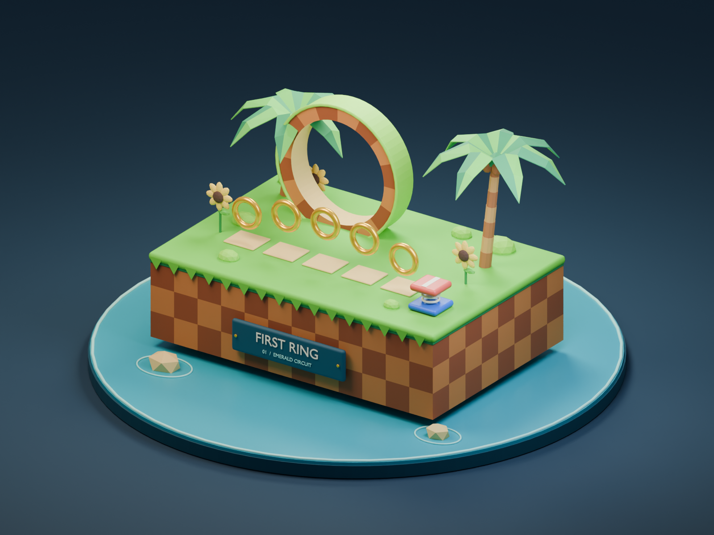

# Sonic Book Projects

I use these Sonic-inspired studies to work through Blender and Unity one chapter at a time. In each project I explain what I made, which parts of the lesson I used, and why I made my own design choices.



## Books

| Book directory | Chapters | Start here |
| --- | --- | --- |
| [`mixing-unity-and-blender`](books/mixing-unity-and-blender/) — working name; full book title and edition pending | 01 and 03 | [First Ring diorama](books/mixing-unity-and-blender/chapter-01-mixing-unity-and-blender/) · [Unity prototyping setup](books/mixing-unity-and-blender/chapter-03-prototyping-in-unity/) |

## How the collection works

```text
books/
  <book-name>/
    README.md
    chapter-01-<chapter-name>/
      README.md       # Lesson, my approach, reasons, instructions, evidence
      blender/        # Editable .blend sources
      scripts/        # Reproducible modeling/export/validation tools
      unity/          # Engine project when the lesson needs one
      previews/       # Actual renders, labeled by application
      verification/   # Recorded checks and artifact hashes
templates/
  CHAPTER_README.md
```

- Every chapter gets its own README using the [chapter template](templates/CHAPTER_README.md).
- Each chapter is self-contained. Later work leaves earlier lessons usable.
- The `.blend` files are editable source; the scripts explain and reproduce
  the construction. Generated assets and previews are included for easy review.
- Unity caches and Blender recovery copies stay out of Git. Unity `.meta`
  files, package locks, source scenes, and exports stay in Git.
- Chapters report the versions and checks actually used, including limitations.

## Open a project

Clone this repository, choose a chapter, and follow its README. Chapter 1
includes a ready-to-open Blender file and a Unity project; rebuilding is optional.
The current files are small enough for ordinary Git, with no Git LFS requirement.

## Provenance

I made the geometry, palette, scripts, and scenes for these exercises. The repository does not include publisher chapter text,
screenshots, code bundles, or extracted game assets.

Sonic the Hedgehog belongs to SEGA. This is an unofficial educational fan
project and is not affiliated with or endorsed by SEGA or the book publisher.

I license my original code, documentation, and artwork under the [MIT License](LICENSE). I also offer the prose I wrote for the chapter READMEs under [CC BY 4.0](LICENSES/CC-BY-4.0.txt). Either license can be used for that text. The book, Sonic characters and trademarks, and third-party packages retain their respective terms.
