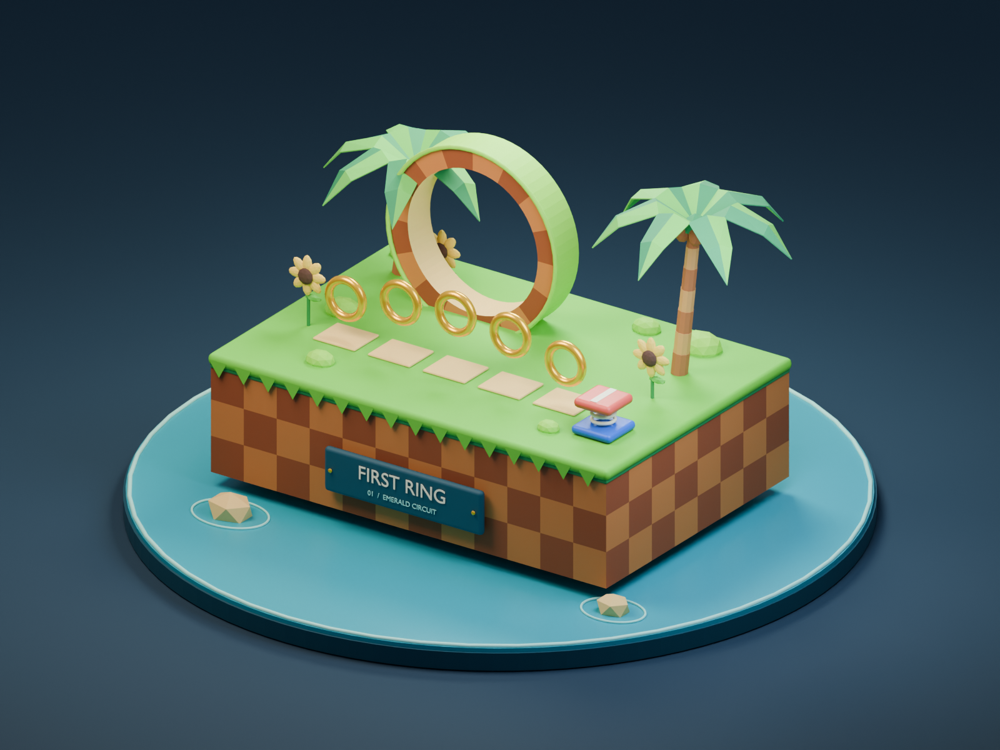

# Chapter 1 — Mixing Unity and Blender

**My project: First Ring / Emerald Circuit** — an original Sonic-inspired
island diorama built in Blender and imported into Unity.



*Blender Cycles render of the editable source scene.*

## What this chapter teaches

The first lesson establishes the connection between two tools. Blender is
where I author geometry and materials; Unity is where I assemble those
assets into a scene that an engine can display. The important outcome is a
repeatable path from an editable model to a correctly positioned, visible
asset in Unity.

The supplied chapter introduces Unity Hub, projects and scenes, the difference
between Scene and Game views, saving Blender artwork, importing it, and
adjusting a camera's near clipping plane. It also introduces the housekeeping
needed when Blender backup files and Unity assets live near each other.

My version demonstrates those ideas with a more recognizable subject than a
default cube. It remains a **static import exercise**: the rings and spring
are decorative meshes, with no collection, bounce, collision, or player controls.

## My Sonic-inspired project

The island combines a checkerboard cliff, grassy loop, two angular palms,
five gold rings, stepping stones, sunflowers, a red-and-blue spring, and a
small ocean base. The plaque names my scene rather than copying a game logo.

Everything is made from primitives or small explicitly modeled meshes.
Objects have readable names such as `Ring_03`, `GrassCap`, and `OceanSurface`.
Blender collections separate the island, palms, rings, path, details, sign,
ocean, and presentation rig, making it practical to inspect or change one part.

## My approach and why

| Decision | Why I chose it | Difference or tradeoff |
| --- | --- | --- |
| A small island instead of the default cube | Rings, foliage, a loop, and a checker pattern exercise rotations, shapes, and multiple materials while giving the lesson a Sonic theme. | More geometry than the book's first example; still a static scene. |
| Keep `FirstRing.blend` in `blender/`; explicitly export an FBX into Unity | The source stays editable, and Unity can open the committed project without invoking a locally installed Blender converter. Export settings are visible and repeatable. | Unlike the book's direct `.blend` import, saving the source alone does not update Unity. Run the export step. |
| Use face-assigned colors and simple Principled materials | The checker pattern is geometry with alternating material assignments, so it survives export without baking a Blender procedural shader. | No texture-painting or UV workflow in this chapter. |
| Recreate materials with URP Lit | The export manifest carries base color, metallic, and roughness values; Unity uses smoothness = `1 − roughness`. This avoids relying on automatic shader conversion. | Blender and Unity use different lighting and tone mapping, so their renders are not identical. |
| Give each application its own camera and lighting | The `Studio` collection is only for the Blender presentation. Unity gets one clearly identified main camera and its own lights, avoiding competing imported cameras. | I practice clipping explicitly rather than reproducing the book's imported-camera clipping problem. Both cameras start at `0.01 m`. |
| Use one metre per unit and an identity transform for the imported root | A known scale and named landmarks let us verify the coordinate conversion instead of adjusting the model until it merely looks right. | The FBX export/import settings must stay consistent. |
| Include construction and export scripts alongside the native file | The model is editable in Blender, while the script records how it was assembled and can reproduce the baseline. | Regenerating the baseline replaces manual model edits; exporting the saved file preserves them. |
| Ignore backup files in Git and keep source outside `Assets` | Blender recovery copies remain available locally without entering Unity or cluttering the repository. | I kept my existing Blender backup settings. |

### A compatibility adjustment on this machine

The installed Linux build pairs Blender **5.0.0** with Python **3.14.7**.
Its FBX operator exposes only some options because of Blender issue
[#152809](https://projects.blender.org/blender/blender/issues/152809).
The export script checks for the missing selection option and, when necessary,
calls the **same bundled FBX exporter backend** with explicit settings. It
does not patch Blender or install an add-on. Builds with the normal operator
use the normal path; that path has not been tested here.

## Tools and versions

| Tool | Actually used | Relationship to the supplied chapter |
| --- | --- | --- |
| Blender | **5.0.0**, Python **3.14.7**, Linux | The book recommends 5.1 or 5.2 LTS. Those versions were not tested here. |
| Unity Editor | **6000.3.4f1** | Unity 6.3 LTS; a different patch from the book's `6000.3.10f1` example. |
| Universal Render Pipeline | **17.3.0** | Version recorded in the project's package manifest and lock. |
| Rendering | Blender Cycles CPU / AgX; Unity URP / ACES | Each preview is labeled by its actual renderer. |

Use the pinned Unity version when reproducing this chapter. A different editor
may upgrade project settings or packages. Unity's first import requires access
to its package registry and a working editor license.

## Project files

| Path | Purpose |
| --- | --- |
| [`blender/FirstRing.blend`](blender/FirstRing.blend) | Editable meshes, materials, collections, camera, lights, and an embedded `START HERE` note. |
| [`scripts/build_scene.py`](scripts/build_scene.py) | Constructs the original scene, saves the source, and exports the artwork; optionally renders the Blender preview. |
| [`scripts/export_scene.py`](scripts/export_scene.py) | Exports the saved artwork while preserving manual edits. Excludes the `Studio` collection. |
| [`scripts/validate_blend.py`](scripts/validate_blend.py) | Checks the reopened native file against the export manifest. |
| [`unity/`](unity/) | Complete Unity project: `Assets`, `Packages`, and `ProjectSettings`. |
| [`unity/Assets/Art/`](unity/Assets/Art/) | FBX, prefab variant, URP materials, and the source export manifest. |
| [`unity/Assets/Scenes/FirstRing.unity`](unity/Assets/Scenes/FirstRing.unity) | Saved engine scene with the artwork, camera, lights, floor, and global volume. |
| [`unity/Assets/Editor/ChapterBuilder.cs`](unity/Assets/Editor/ChapterBuilder.cs) | Editor menus to rebuild the scene, verify the import, and capture a Unity preview. No runtime gameplay code. |
| [`previews/`](previews/) / [`verification/`](verification/) | Actual rendered images and recorded validation results. |

## Open and explore

1. Open `blender/FirstRing.blend` in Blender. Press **Numpad 0** for the camera
   view and **F12** to render. Expand the collections in the Outliner and
   select a ring or palm to inspect its mesh. The `START HERE` text block is
   available in Blender's Text Editor.
2. In Unity Hub, add the existing **`unity` directory** as a project and open
   it with **6000.3.4f1**. Allow package resolution and the first asset import
   to finish.
3. Open **Assets → Scenes → FirstRing**. Select the `FirstRing` root in the
   Hierarchy and press **F** in the Scene view to frame it. Expand it to see
   the imported objects. Its position and rotation are zero, and its scale is one.
4. Switch to **Game** to see the main camera's composition. A **4:3** aspect
   ratio matches the previews. Play mode displays the same static scene;
   movement and input handling are outside this chapter.
5. Select **Main Camera (Unity)** to inspect the near clipping plane (`0.01`).
   Temporarily raise it to `30` and observe how nearby geometry is cut away;
   restore `0.01` afterward. This is a camera visibility setting, not a hole
   in the mesh.


*Unity URP camera render of the imported FBX, with Unity materials and lights.*

## Rebuild and try a change

Run the following commands from **this chapter directory**. They assume
`blender` is available on your command path. Close the project in Unity before
running a second Unity editor process against it.

### Preserve a manual Blender edit

Select `Ring_03` in Blender, press **G**, **Z**, type **0.25**, and press
**Enter**. Save the `.blend`, then export it:

```bash
blender --background blender/FirstRing.blend --python-exit-code 1 --python scripts/export_scene.py
blender --background blender/FirstRing.blend --python-exit-code 1 --python scripts/validate_blend.py
```

The export replaces `unity/Assets/Art/FirstRing.fbx` and `scene-manifest.json`.
Open Unity and choose **Book Projects → Chapter 01 → Rebuild Unity Scene**.
The raised ring should appear above its old position. Blender's vertical **Z**
becomes Unity's vertical **Y**. Rebuilding recreates the Unity scene, prefab,
palette, and presentation settings; save separate copies of any custom Unity
scene work first.

For command-line Unity rebuilding, set the executable path for your system:

```bash
UNITY="/path/to/Unity/Editor/Unity"
"$UNITY" -batchmode -nographics -quit -projectPath "$PWD/unity" \
  -executeMethod SonicBook.Chapter01.ChapterBuilder.Build -logFile /tmp/first-ring-build.log
```

The saved `.blend` is the source for this workflow. **Do not run the construction
script to export a manual edit**: it deliberately recreates the baseline scene.

### Recreate the baseline

This replaces the native source and FBX with the scripted original and renders
a new Blender preview:

```bash
blender --background --factory-startup --python-exit-code 1 --python scripts/build_scene.py -- --render
blender --background blender/FirstRing.blend --python-exit-code 1 --python scripts/validate_blend.py
```

Then run the Unity rebuild command or menu above. To refresh the Unity image,
choose **Book Projects → Chapter 01 → Capture Unity Preview**. It requires
graphics support. The capture waits for the editor to initialize, renders a
warm-up frame, and saves the following frame. On the tested installation, the
first request produced an incomplete dark image; waiting between full-frame
requests preserved the intended lighting and ACES tone mapping. The script
temporarily makes shader compilation synchronous and restores that setting
after capture.

The following Linux command uses the OpenGL backend used for my preview.
The capture exits the batch process itself; omit both `-nographics` and `-quit`:

```bash
"$UNITY" -batchmode -force-glcore -projectPath "$PWD/unity" \
  -executeMethod SonicBook.Chapter01.ChapterBuilder.CapturePreview -logFile /tmp/first-ring-preview.log
```

Re-render previews after changing the scene so the images describe the actual
saved project. Verification reports describe the files at the time they were
checked; regenerate them after edits.

## Verification and limitations

- The generated `.blend` was saved, reopened in Blender, and checked against
  the export manifest: **124 artwork meshes, five named rings, 24,848 evaluated
  triangles**, metre scale, `0.01` camera near clip, valid material assignments,
  and no external textures or linked libraries.
- Unity compiled the editor script, imported the FBX, and rebuilt the scene.
  It contains **124 imported meshes, 24,848 triangles, and 19 URP Lit materials**.
  The artwork root retains an identity transform and the scene has one camera.
- The imported artwork spans approximately **14.1 × 6.825 × 14.1 metres**
  in Unity's X/Y/Z axes. Named landmarks confirm the observed mapping
  **Blender `(x, y, z)` → Unity `(x, z, y)`** for these export/import settings.
- Both **1600 × 1200** previews were rendered and visually inspected. The
  island, five rings, loop, palms, spring, and plaque appear in both. Lighting
  and surface reflections differ between Cycles and URP, as expected from
  their separate presentation rigs; the material values match the manifest.
- The results are recorded in [Blender checks](verification/blender-checks.json)
  and [Unity checks](verification/unity-checks.json). Artifact hashes are in
  [the build manifest](verification/build-info.json).

This verifies the static art workflow on the versions above. It does not test
Blender 5.1/5.2, other operating systems, a standalone player build, collision,
character movement, or gameplay. The many separate objects are useful for
learning and editing; this is not a batching or performance optimization study.

## What I learned / next chapter

An engine import needs more than a file appearing in a browser: the scene must
have the intended scale, orientation, materials, and a useful camera. Keeping
the native source, explicit export, and engine presentation distinct makes
those responsibilities easier to inspect and reproduce.

The supplied chapter identifies **materials and transformations** as the next
topic. That lesson will get its own project directory and README when supplied,
leaving this first chapter available as a working reference.

## References and provenance

- Source lesson: **Chapter 1, “Mixing Unity and Blender.”** Full book title and
  edition are pending. This README summarizes the lesson in original words;
  the publisher's text, screenshots, and downloadable bundle are not included.
- [Unity 6.3: Importing objects from 3D modeling applications](https://docs.unity3d.com/6000.3/Documentation/Manual/HOWTO-ImportObjectsFrom3DApps.html)
  explains exported formats and the external-application dependency of native imports.
- [Unity 6.3: Render requests in URP](https://docs.unity3d.com/6000.3/Documentation/Manual/urp/User-Render-Requests.html)
  documents the API used to capture the actual Unity preview.
- Blender's [Python 3.14 FBX operator fix](https://projects.blender.org/blender/blender/commit/d7d8e7a1df12c405d62e92be56cfb55eada85a4b)
  records the annotation issue handled by my local exporter fallback.

All scene geometry, palette choices, and project scripts were created for this
exercise; no game models, sprites, textures, or music were extracted. Sonic
the Hedgehog belongs to SEGA. This is an unofficial educational fan project.

## Reusing my chapter notes

I offer my original prose in this guide under either the [MIT License](../../../LICENSE) or [CC BY 4.0](../../../LICENSES/CC-BY-4.0.txt). Please credit Christian Busca when reusing the text under CC BY.
